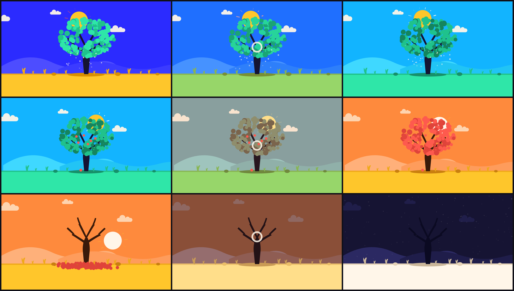

# GCfango — Code-Driven Motion Graphics Skill
> **Deterministic, Pure-Code Animation & Algorithmic Audio Synthesis Pipeline**

GCfango 是基于纯代码驱动的高精度动态图形（Motion Graphics, MG）创作与音视频合成 Skill。区别于概率性扩散/文生视频模型（画面易形变、闪烁、文字崩溃、无法毫秒级定点修改），本架构将整部片子抽象为**纯时间函数**，实现 100% 确定性、无损矢量边缘、以及音画帧级咬合。

---

## 视觉范例：30 秒扁平矢量长视频《一棵树的三十秒》

本仓库内置了完整 30 秒长视频实战工程 `demos/30-tree/`：

| 盛夏繁茂（视觉与音乐 Drop） | 寒冬静夜与新芽破土（时空闭环） |
| :---: | :---: |
|  |  |

### 四季色彩矩阵连续渐变（Contact Sheet）


---

## 核心设计哲学 (Core Architecture)

### 1. 纯时间函数契约 (Pure Function of Time)
```javascript
window.renderAt = async (t) => { ... }
```
- **绝对无状态 (Stateless)**：任意时刻 `t`（秒）的画面是完全由 `t` 计算得出的唯一定态。禁止依赖 `requestAnimationFrame` 累加变量、内部轮询或随机数累加（所有随机必须是伪随机种子 `rng(seed)`）。
- **时间任意穿梭 (Scrubbable)**：可以毫秒级渲染任意单帧，单帧修改只调对应时间区间的数学公式，绝不影响前后帧。

### 2. 运动物理与过冲曲线 (Spring & Overshoot Math)
MG 动画灵动感的核心在于**非线性物理反馈**：
- **阻尼弹簧 (Damped Spring)**:
  $$s(t) = 1 - e^{-a t} \left(\cos(b t) + \frac{a}{b} \sin(b t)\right)$$
- **挤压与拉伸 (Squash & Stretch)**:
  速度最大时发生形变，到达极值时反弹。
- **经典过冲 (Pop / outB)**:
  物体到达目标位置时会先冲过约 10%–20%，再拉回稳定，模拟机械或橡胶弹性。

```javascript
function spring(t, f = 2, z = 0.4) {
  if (t <= 0) return 0;
  const w = 2 * Math.PI * f, a = z * w, b = w * Math.sqrt(1 - z * z);
  return 1 - Math.exp(-a * t) * (Math.cos(b * t) + (a / b) * Math.sin(b * t));
}
function pop(t, t0, f = 2.4, z = 0.42, amt = 0.14, pin = 0.9) {
  const tt = t - t0;
  const s = spring(tt, f, z);
  const vel = tt > 0 ? Math.exp(-z * 2 * Math.PI * f * tt) * Math.sin(2 * Math.PI * f * Math.sqrt(1 - z * z) * tt) : 0;
  const w = E.ioQ(inv(pin * 0.7, pin, tt));
  return [lerp(s, 1, w), lerp(vel * amt, 0, w)];
}
```

### 3. 色彩矩阵平滑演进 (`paletteAt`)
长视频容易疲劳，通过预设多套饱和对比色卡，并在转场区间进行三通道平滑插值：
```javascript
function paletteAt(t) {
  const trans = [
    { tw: W1, from: 0, to: 1 }, // 春 -> 夏
    { tw: W2, from: 1, to: 2 }, // 夏 -> 秋
    { tw: W3, from: 2, to: 3 }, // 秋 -> 冬
  ];
  for (const tr of trans) {
    const d = t - tr.tw;
    if (Math.abs(d) <= TDUR / 2) {
      const u = inv(tr.tw - TDUR / 2, tr.tw + TDUR / 2, t);
      const e = u * u * (3 - 2 * u); // smoothstep
      const A = SEA[tr.from], B = SEA[tr.to];
      const res = {};
      for (const k in A) {
        res[k] = (typeof A[k] === 'string' && A[k].startsWith('#')) ? mixh(A[k], B[k], e) : (e < 0.5 ? A[k] : B[k]);
      }
      return res;
    }
  }
  return SEA[seasonOf(t)];
}
```

### 4. 单一摄像机组 (Unified Camera Rig)
全片所有图元置于一个顶层 `<g id="world">` 下，摄像机运动即一组平滑矩阵：
```javascript
const CAM = [
  [0.0, 1.00, 960, 520],
  [8.2, 1.05, 960, 520],
  [15.8, 1.00, 960, 500],
  [22.8, 1.06, 960, 556],
  [26.6, 1.04, 958, 562],
  [30.0, 1.30, 942, 560], // 结尾推镜同时保证树冠顶与地表新芽均在画幅内
];
```

### 5. 音画单点真理 (Single Source of Truth: cues.json)
- 画面与声音共享一份 `cues.json`，只记录**帧号 (Frame Number)**。
- 画面在 `frame: 24` 发生落地，音频就在 `T('seed_land') = 24 / fps` 触发打击音效。
- 任何节奏调整只需在 `cues.json` 改动一次，双端自动同步，杜绝“改了画面声音漂移”。

```json
{
  "fps": 30,
  "duration": 30.0,
  "bpm": 120,
  "key": "F",
  "cues": [
    { "frame": 24,  "name": "seed_land",     "what": "种子触地，冲击环扩散" },
    { "frame": 32,  "name": "sprout",        "what": "树干破土，纵向弹起" },
    { "frame": 130, "name": "summer_in",     "what": "入夏，青色天空接管" }
  ]
}
```

### 6. 广播级声学合成与母带 (Algorithmic Audio & QC)
- 基于 Python `mgaudio`，不依赖外部版权音乐库。
- 自动和弦进行、Drop 能量曲线、滤波器包络自动化、母带动态压缩与响度规整（-14 LUFS，True Peak ≤ -1.5 dBFS）。

---

## 快速上手与操作指南

### 1. 环境准备
```bash
git clone https://github.com/zerox-core/GCfango.git
cd GCfango

# 安装前端渲染依赖 (Puppeteer Core 无头渲染器)
npm install

# 安装音频合成依赖
pip install -r requirements.txt
pip install pyloudnorm pedalboard
```

### 2. 生成配乐与音效
```bash
python demos/30-tree/audio.py
```
控制台会输出声学 QC 检测报告（包含 LUFS、True Peak、频段能量占比及警告检测）。

### 3. 渲染高清视频
```bash
# 快速导出关键帧静帧以供检查构图与色彩
node harness/render.mjs demos/30-tree --stills 2.0,8.2,15.8,22.8,29.5

# 导出完整 30 秒广播级 1080p 60fps/30fps MP4
node harness/render.mjs demos/30-tree --crf 16
```
产物将自动合并音轨并输出至 `demos/30-tree/out/video.mp4`。
